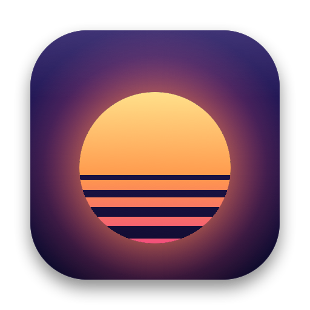

<p align="center"></p>

<h1 align="center">Dusk: free blue light filter and flicker-free screen dimmer for Mac</h1>

<p align="center"><b>Warm screen. Calm eyes.</b><br>
Free, open-source macOS menu-bar app that warms your screen down to 500K, dims below the lowest brightness, and reduces PWM flicker and temporal dithering on MacBooks.</p>

<p align="center">
<a href="https://github.com/s-azizkhan/dusk-mac/releases/latest"><b>Download for macOS</b></a> ·
<a href="https://s-azizkhan.github.io/dusk-mac/">Website</a> ·
<a href="#faq">FAQ</a>
</p>

---

Dusk is a free and open-source alternative to f.lux, Apple Night Shift, Sundown, Iris and GammaDimmer. It runs fully on your Mac: no account, no analytics, no network calls.

## Features

- **Blue light filter:** colour temperature from 6500K (daylight) down to 500K (deep red), warmer than Night Shift (~2700K) or f.lux (1200K).
- **7 warmth presets:** Energy, Daylight, Evening, Night, Late, Deep, Midnight.
- **Screen dimming below minimum brightness:** software dimming to 5%, for dark rooms and late nights.
- **Flicker-free mode (PWM):** holds the built-in backlight at 100% and dims through the gamma table instead, so the backlight is not pulsed at low brightness.
- **Disable temporal dithering:** turns off GPU/DCP dithering on Apple silicon Macs (M1, M2, M3, M4).
- **Night schedule:** warms automatically between the hours you pick.
- **Launch at login**, menu-bar only, re-applies after sleep and display changes.
- **Private by design:** no account, no telemetry, no internet access needed.

## Download and install

### Homebrew

```sh
brew install --cask s-azizkhan/tap/dusk
```

### Manual

1. Download `Dusk-macOS.zip` from [the latest release](https://github.com/s-azizkhan/dusk-mac/releases/latest).
2. Unzip and move `Dusk.app` to Applications.
3. The build is ad-hoc signed (not notarised yet). Allow it once:
   ```sh
   xattr -dr com.apple.quarantine /Applications/Dusk.app
   ```
4. Open Dusk. The sun icon appears in the menu bar.

Requires macOS 14 Sonoma or later.

## Build from source

```sh
git clone https://github.com/s-azizkhan/dusk-mac.git
cd dusk-mac
./build.sh
open build/Dusk.app
```

Needs Xcode or the Xcode Command Line Tools.

## Dusk vs Night Shift vs f.lux vs Sundown

| | Dusk | Night Shift | f.lux | Sundown |
|---|---|---|---|---|
| Price | Free | Free (built in) | Free | $4.99/mo, $39/yr or $79 lifetime |
| Open source | Yes (MIT) | No | No | No |
| Warmest setting | 500K | ~2700K | 1200K | 500K |
| Dim below minimum brightness | Yes | No | No | Yes |
| PWM flicker-free mode | Yes | No | No | Yes |
| Disable temporal dithering | Yes | No | No | Yes |
| Account or network needed | No | No | No | Licence activation |

Prices and features of other apps are from their public websites as of November 2026.

## How it works

- **Warmth and dimming:** `CGSetDisplayTransferByFormula` on every active display, read back to confirm macOS applied it.
- **Flicker-free:** the private `DisplayServices` brightness API holds the built-in backlight at 100% (same approach as MonitorControl). Dusk skips this when the gamma read-back fails, so the screen never jumps to full brightness.
- **Temporal dithering:** sets the IORegistry property `enableDither = false` on `IOMobileFramebufferAP` services (same approach as Stillcolor). macOS resets it on reboot; Dusk re-applies it on launch.

## FAQ

### Is there a free alternative to f.lux, Sundown or Iris for Mac?
Yes. Dusk is free and open source (MIT). It covers the blue light filter, dimming below minimum brightness, flicker-free mode and anti-dithering.

### How do I reduce PWM flicker on a MacBook?
Many MacBook displays dim the backlight with PWM, which pulses it on and off. Turn on **Flicker-free** in Dusk: the backlight stays at 100% and brightness is lowered in software instead.

### How do I disable temporal dithering on an Apple silicon Mac?
Open Dusk, expand **Display health** and turn on **No dithering**. Check it with `ioreg -lw0 | grep -i enableDither`, which should show `No`.

### How is Dusk different from Night Shift?
Night Shift stops around 2700K and cannot dim below the minimum brightness or address flicker. Dusk goes down to 500K, dims to 5% and has flicker-free and anti-dithering modes.

### Does Dusk help with eye strain or sleep?
Dusk is a display utility, not a medical device. Many people find a warmer, dimmer screen more comfortable at night. Talk to a doctor about medical concerns.

### Does Dusk work with external monitors?
Warmth and dimming work on all displays. Flicker-free mode applies to the built-in display only.

### Is Dusk safe? Does it collect data?
Dusk makes no network requests and has no analytics. The full source is in this repository.

## Known limitations

- Private macOS APIs can change in any macOS update.
- Flicker reduction has not been measured with an oscilloscope yet. Check with a slow-motion phone camera.
- The panel's own dithering (FRC) cannot be controlled from software.
- Some macOS 26 releases have gamma bugs; Dusk shows a warning when gamma is not applied.

## Brand

| | |
|---|---|
| Name | Dusk |
| Tagline | Warm screen. Calm eyes. |
| Palette | Night `#0E0A2A` · Indigo `#2A1D66` · Rose `#F2507B` · Ember `#FF9A4D` · Sun `#FFE08A` |
| Mark | Slit sun: a sun cut by horizontal bands in its lower half |
| Icon source | `tools/make-icon.swift` regenerates `Resources/Dusk.icns` and `docs/icon.png` |

## Credits

Built on ideas from [Stillcolor](https://github.com/aiaf/Stillcolor), [MonitorControl](https://github.com/MonitorControl/MonitorControl) and [Dimit](https://github.com/azakapro/dimit).

## License

MIT © s-azizkhan

<sub>Keywords: blue light filter mac, night shift alternative, f.lux alternative, sundown alternative, free screen dimmer mac, pwm flicker macbook, flicker free mac, disable temporal dithering apple silicon, dim screen below minimum brightness mac, red light filter mac, eye strain mac app, color temperature menu bar app, open source macOS utility.</sub>
